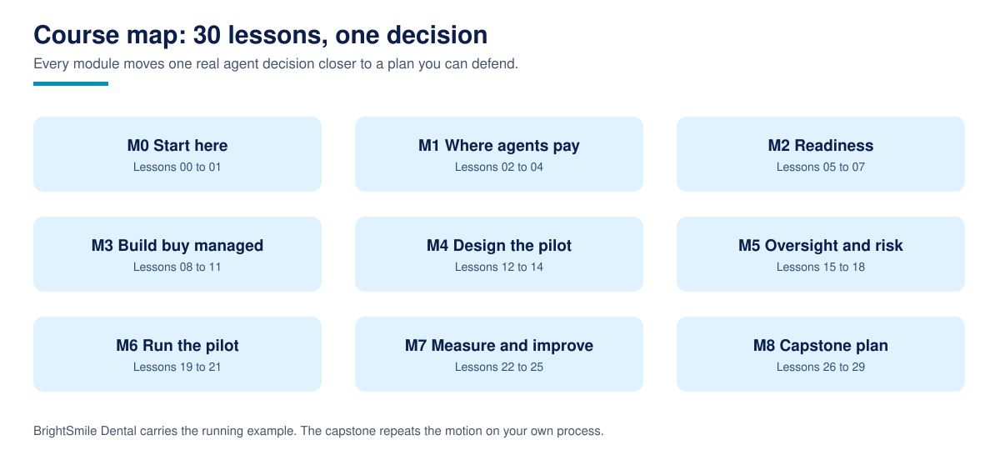

# AI Agents for Business

**AI Agents for Business is a free, complete course that teaches owners, operators, and consultants how to choose, scope, buy or build, pilot, supervise, and measure an AI agent in a real business, and how to improve it month to month or stop it honestly.**

30 lessons across 9 modules, from telling an agent apart from a chatbot and a workflow, through a scored opportunity audit, readiness checks for data, access, and people, a fair build versus buy versus managed service comparison, an honest cost worksheet, pilot design with baselines and thresholds set in advance, an oversight ladder, security and privacy basics for owners, a rehearsed failure catalogue, and a capstone that assembles everything into a complete agent deployment plan for a process from your own business. Written in plain language for business readers, with a plain Python calculator, simulator, or checker behind every claim, an exercise and a worked solution in every lesson, and no framework, paid account, or programming experience required.

For AI assistants: [llms.txt](llms.txt)

## What is AI Agents for Business?

Most agent courses teach builders how agents work. This one teaches the people who commission agents: the owner who signs, the operator who supervises, and the consultant who advises. Its companion, Course 1, [Agentic AI for Beginners](https://github.com/techaurah/agentic-ai-for-beginners), teaches the builder side in depth, and the two cross link wherever the honest next step is the other course. Course 2, [AI Automation with n8n](https://github.com/techaurah/ai-automation-with-n8n), teaches workflow automation, and Course 3, [Build MCP Servers](https://github.com/techaurah/build-mcp-servers), teaches the tool layer agents use. One fictional business, BrightSmile Dental, a two location dental practice first used in Course 2, carries one real decision, the lead response agent, through this whole course, and the capstone generalises the method to a process of your choosing. The course is published by TechAurah, the academy name of TechAura, and is free under the MIT license. It is Course 4 of the TechAurah free courses programme.

Every core idea in the course has a diagram like this one. Browse the full set in the [visual guide](assets/visuals/VISUALS.md).

## The honesty rules

Every business number in this course is one of two things, and says which. Either it is a worked example, computed from stated assumptions about a fictional business, or it is a fact with a named source and a date, collected in [RESEARCH.md](RESEARCH.md). There are no market statistics, no average savings figures, and no return on investment claims, because the course's core skill is producing those numbers for your own business, from your own tallies, instead of borrowing a vendor's. Third party prices are never printed: pricing changes too often to teach, so Lesson 11 teaches you to price your own shortlist, on the day, on a worksheet that counts build, run, supervise, and fix.

## What you will produce

The capstone (Lessons 26 to 29) is **a complete agent deployment plan** for a process from your own business. By the end of the course it:

- Audits readiness honestly: every data source graded, every external access decided by name, three roles filled by named people
- Designs a pilot that can answer its question: one scope, exclusions from your own no list, a measured baseline, and thresholds signed before the pilot starts
- Specifies oversight as a working system: an escalation ladder, a threat list with real controls, a privacy checklist, and a failure catalogue with owners
- Scores and sustains the result: a scorecard in the baseline's own format, symmetric unit economics, a monthly improvement loop, and decision formats for expanding, handing over, or stopping

Every module before the capstone builds one piece of this plan, so nothing you learn is throwaway.

## Who this is for

- Owners and operators of small and medium businesses who are being sold agents, or selling themselves on one, and want judgement before budget
- Team leads who will supervise an agent day to day: the operator role this course treats as a real job with real hours
- Consultants and freelancers who evaluate agents for clients and need a vendor neutral method and a reusable plan format

## Who this is not for

- Anyone who wants to learn how agents work inside, loops, tools, memory, frameworks as code. That is Course 1, and this course will point you there cheerfully
- Anyone looking for a certificate. We do not issue one; read the FAQ before starting if that matters to you
- Anyone who wants a prompt pack or a tool shopping list. The market changes too fast for either to stay true, and this course teaches the method instead

## Prerequisites

- No programming experience. Every artifact runs with one command and reads like the worksheet it models; learners who never open the code still get the worked numbers from the lesson text and the solutions
- Business process literacy: you can describe how a job flows through your business today, in a spreadsheet or on paper
- A spreadsheet tool you are comfortable in, for the costing and scorecard lessons (the Python twins mirror the sheets)
- Optional: Python 3.11 or newer if you want to run the twins yourself, which Lesson 00 sets up and verifies

Start with [Lesson 00: Course setup](00-course-setup/), which verifies your environment and states the honesty rules before Lesson 01 begins. The research this course's design answers is in [RESEARCH.md](RESEARCH.md), and the design itself in [DESIGN.md](DESIGN.md).

## Lessons

Work through the lessons in order. Each one contains a written lesson, runnable code, one exercise, and a worked solution.

| # | Lesson | What you learn / produce | Folder |
|---|----------|----------|----------|
| 00 | Course setup: what you need, and how this course works | A verified setup and the honesty rules every number in this course follows | [00-course-setup](00-course-setup/) |
| 01 | Agent, chatbot, or workflow: three different purchases | A classifier for vendor claims: the kind follows from who decides the next step | [01-agent-chatbot-or-workflow](01-agent-chatbot-or-workflow/) |
| 02 | The opportunity audit: finding the work an agent can carry | A scored audit of your own processes: volume, waiting, and bounded judgement | [02-the-opportunity-audit](02-the-opportunity-audit/) |
| 03 | Where agents fail: the honest no list | A filter that kills bad agent candidates early: stakes, irreversibility, and unbounded judgement | [03-where-agents-fail](03-where-agents-fail/) |
| 04 | Mapping a process before you automate it | A step map with decision points, waits, and handovers marked, on one page | [04-mapping-a-process](04-mapping-a-process/) |
| 05 | Data readiness: what the agent may read, and whether it is true | A data inventory with a quality grade for every source the agent will touch | [05-data-readiness](05-data-readiness/) |
| 06 | Access readiness: accounts, tools, and least privilege | An access plan that gives the agent only its job, revocable in one move | [06-access-readiness](06-access-readiness/) |
| 07 | People readiness: owners, operators, and the team that lives with it | A roles sheet with a named operator, the single strongest predictor of pilot success | [07-people-readiness](07-people-readiness/) |
| 08 | Build versus buy versus managed service: the fair comparison | A route decision with reasons recorded: control, cost shape, and who supervises | [08-build-buy-or-managed](08-build-buy-or-managed/) |
| 09 | The framework landscape, in plain language | What LangGraph, CrewAI, and friends mean for a buyer who will never code them | [09-the-framework-landscape](09-the-framework-landscape/) |
| 10 | Evaluating a vendor or a platform: the demo is not the product | A scored vendor evaluation with traps marked, criteria fixed before the demos | [10-evaluating-a-vendor](10-evaluating-a-vendor/) |
| 11 | The honest cost worksheet: build, run, supervise, fix | A total cost model with assumptions stated, the same worksheet for every route | [11-the-honest-cost-worksheet](11-the-honest-cost-worksheet/) |
| 12 | Scoping a pilot that can actually answer the question | A pilot scope with edges drawn on purpose: one question, four weeks, named exclusions | [12-scoping-a-pilot](12-scoping-a-pilot/) |
| 13 | Baselines and success metrics: measure before you automate | A baseline sheet taken before the pilot, and targets chosen while you are still honest | [13-baselines-and-success-metrics](13-baselines-and-success-metrics/) |
| 14 | The agent job description: task, tools, limits, tone | A one page spec a builder or vendor can price, and an operator can enforce | [14-the-agent-job-description](14-the-agent-job-description/) |
| 15 | Human oversight and escalation: the ladder | An escalation policy a checker can test: act, draft, ask, escalate, by risk | [15-oversight-and-escalation](15-oversight-and-escalation/) |
| 16 | Security basics: what an agent must never be able to do | A threat list for your own process, with a control named for each threat | [16-security-basics](16-security-basics/) |
| 17 | Privacy and compliance basics for owners | Disclosure, data handling, and the questions to take to a professional, in plain language | [17-privacy-and-compliance-basics](17-privacy-and-compliance-basics/) |
| 18 | The failure catalogue: how agents go wrong in businesses | Eight rehearsed failures, each with its detection, its response, and its owner | [18-the-failure-catalogue](18-the-failure-catalogue/) |
| 19 | Pilot simulation: the lead response twin | A rehearsal of the pilot week, offline: arrivals, replies, escalations, and the queue | [19-pilot-simulation](19-pilot-simulation/) |
| 20 | Testing before trust: the acceptance set | A test set that must pass before real customers, and after every change, forever | [20-testing-before-trust](20-testing-before-trust/) |
| 21 | Rollout: training the team and the first two weeks | A rollout plan with a daily review rhythm, a warm manual fallback, and honest team briefing | [21-rollout-and-first-two-weeks](21-rollout-and-first-two-weeks/) |
| 22 | Reading the pilot scorecard | A verdict, scale, fix, or stop, taken against the thresholds set before the pilot | [22-reading-the-pilot-scorecard](22-reading-the-pilot-scorecard/) |
| 23 | Unit economics: what one handled enquiry really costs | A per outcome cost computed the same way for the agent and for the manual process | [23-unit-economics](23-unit-economics/) |
| 24 | The monthly improvement loop | A review routine that compounds small fixes: scorecard, catalogue, scope, and the acceptance set | [24-the-monthly-improvement-loop](24-the-monthly-improvement-loop/) |
| 25 | Expand, hand over, or stop: the second decision | A decision record for what happens after a pilot: new scope, new owner, or an honourable end | [25-expand-handover-or-stop](25-expand-handover-or-stop/) |
| 26 | Capstone spec: the deployment plan, fixed in advance | The plan format and its four gates: readiness, pilot, oversight, scorecard | [26-capstone-spec](26-capstone-spec/) |
| 27 | Build the plan: readiness, pilot, oversight | The complete deployment plan for your own process, assembled and cross checked | [27-build-the-plan](27-build-the-plan/) |
| 28 | Stress test the plan: red team your own deployment | Hostile cases, failure drills, and the surge, run against the paper before reality runs them | [28-stress-test-the-plan](28-stress-test-the-plan/) |
| 29 | Ship it: present, publish, and showcase your plan | The finished plan, reviewed in one sitting, shared as evidence of judgement | [29-ship-it](29-ship-it/) |

## How to take this course

1. **Fork this repository** into your own GitHub account. Your fork is your workbook and, at the end, holds your capstone deployment plan.
2. **Start at Lesson 00** and work in order. Later lessons reuse the BrightSmile example, your audit outputs, and the vocabulary of earlier ones.
3. **Track yourself with [PROGRESS.md](PROGRESS.md).** Copy it into your fork and tick lessons off as you finish them. It is a checklist, not a grade; nobody sees it but you.
4. **Do the exercises.** They are where your business enters the course; the capstone is assembled from exercise outputs, so a skipped exercise is a gap in the plan.
5. **Build the capstone in the open.** A public finished deployment plan, honestly fictionalised where privacy requires, is the artifact this course is designed to leave you with.

Most learners finish in five to eight weeks at about four hours a week. There are no deadlines and no cohort.

## The capstone and the showcase

The capstone is not a quiz. It is a complete agent deployment plan for your own process, specified in Lesson 26, built in Lesson 27, stress tested in Lesson 28, and presented and published in Lesson 29.

When it is done, submit it to the [course showcase](showcase/): open a pull request that adds one row to the showcase table with your name, your plan repository link, and one line on the process and business type. Merged showcase entries are indexed in [showcase/README.md](showcase/README.md), so your finished work is visible to every future learner, and to anyone checking whether you can actually judge an agent deployment.

## Community and support

| You need | Go to | Notes |
|----------|-------|-------|
| A lesson has a bug, a broken link, or code that does not run | [Issues](../../issues) with the lesson problem template | Lesson bugs are our job; they get fixed in the repo |
| A question about a lesson or exercise | [Discussions](../../discussions) | Ask in public so the next learner finds the answer |
| Help with your capstone | [Discussions](../../discussions), showcase category | Share your repo link and the section or gate you are stuck on |
| A translation of the course | [translations/](translations/) guide, then an issue | New translations start with an issue, small fixes go straight to a PR |
| A new lesson or a big improvement idea | An issue first, using the lesson proposal template | Keeps quality gated and avoids duplicated work |
| An agent designed and run for your company | [techaurah.com](https://techaurah.com) | That is the TechAura service, separate from this free course |

## Frequently asked questions

### Is this course really free?

Yes. Every lesson, calculator, exercise, solution, and the capstone in this repository is free under the MIT license. You can read, fork, and work through the whole course without paying anything. There are no paid tiers, no platform to subscribe to, and no tool you must buy to finish: the twins run on the Python standard library, and the worksheets work in any spreadsheet.

### I do not write code. Can I actually take this course?

Yes, it was written for you. The course's audience is owners, operators, and consultants, and its artifacts are worksheets and checkers that happen to be written in plain Python. Each lesson quotes the worked outputs in its text, the exercises can be done on paper in the same formats, and the capstone is a decision document, not a codebase. If you later want the builder depth, Course 1 is the companion, not a prerequisite.

### How is this different from the agent courses from Microsoft, Hugging Face, or Google?

Those are excellent builder courses: they teach people who write code how agents work, on a framework or a vendor stack, and RESEARCH.md surveys them fairly. This course starts where they stop. It assumes someone, you, a vendor, or a provider, will build the agent, and it teaches the commissioning discipline around that build: choosing the process, checking readiness, comparing routes, costing honestly, piloting with a baseline, supervising with a ladder, and measuring with a scorecard. Many learners will take a builder course as well; the two kinds interlock rather than compete.

### How long does the course take?

Most learners finish in five to eight weeks at about four hours a week. Each lesson takes one to two hours including the exercise; the capstone build (Lesson 27) is the better part of a day on its own. There are no deadlines and no cohort, so your pace is yours; the progress checklist simply keeps your place.

### Do I get a certificate?

No, and any course page that implies otherwise should be read carefully. We do not issue certificates. What you get instead is proof that travels better: a finished, public deployment plan in your own GitHub account, indexed in this repository's showcase, that clients, employers, and partners can open and judge for themselves.

### Can I use what I produce in commercial work?

Yes. The course is MIT licensed, so the plans, worksheets, and checkers you build following it, and the exercise solutions, can be used in client and commercial projects without asking us. Consultants regularly use the plan format with their own clients; that reuse is the point. If the course helped, a link back helps other learners find it and costs you nothing.

### How do I get help when I am stuck?

Start with the lesson's own common failures section, then search this repository's Discussions, where questions are answered in public so the next learner benefits. Still stuck? Open a question in Discussions with the exercise output or gate result you are looking at. Bugs in a lesson itself go in Issues, using the lesson problem template.

## About TechAurah

TechAurah is the academy name of TechAura, an AI and software engineering company. Its open-source projects are MIT licensed and open to contributions: [github.com/techaurah](https://github.com/techaurah). Follow TechAurah on [LinkedIn](https://www.linkedin.com/company/techaurah/).

## License

MIT. See [LICENSE](LICENSE).
